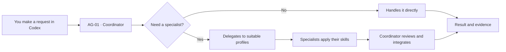

**[Português (Brasil)](README.md) · English · [Español](README.es.md)**

<a id="top"></a>

<p align="center">
  
</p>

<h1 align="center">SixteenSquad</h1>

<p align="center"><strong>Your project. One mission. Sixteen specialties.</strong></p>

<p align="center">
  A reusable team for <strong>Codex</strong> projects: <strong>1 Coordinator, 15 specialists, and 16 skills</strong>.
  Just make requests as you normally would. The Coordinator decides when to work directly and when to bring in specialists.
</p>

<p align="center">
  <a href="LICENSE"></a>
  <a href="https://github.com/Adriano-Medeiros/SixteenSquad/stargazers"></a>
  
</p>

<p align="center">
  <a href="#why-it-exists"><strong>Why it exists</strong></a> ·
  <a href="#how-to-use"><strong>How to use</strong></a> ·
  <a href="#installation">Installation</a> ·
  <a href="#how-it-works">How it works</a> ·
  <a href="#allowance-and-credits">Usage allowance and credits</a> ·
  <a href="#models-and-effort">Models and reasoning effort</a> ·
  <a href="#the-squad">Meet the squad</a> ·
  <a href="#documentation">Documentation</a>
</p>

---

<a id="why-it-exists"></a>

## 01 / Why was SixteenSquad created?

**SixteenSquad was created to help people starting a Codex project who find it difficult to understand how subagents work, when to use them, and how to combine their skills.**

When you begin developing with AI, many questions come up: Do I need to create a separate agent for each area? How do I delegate work? How can specialists collaborate? When should I use a skill? Who checks the results?

SixteenSquad aims to provide a **ready-to-use, understandable starting point**. Instead of building every profile and set of instructions from scratch, you put the Starter files in your project and begin working. The system uses Codex's native capabilities, within the permissions and limitations of your session. **You do not need to buy a separate AI API subscription just to install or use the Starter:** when you sign in to Codex with your ChatGPT account, activities use the allowance or billing method associated with your plan (see [usage allowance and credits](#allowance-and-credits)).

> **The squad metaphor:** the mercenaries in the illustration represent **specialized agents**; their weapons and equipment represent their **skills**—tools and procedures for each mission. This is a visual metaphor, not a military feature of the software. The Coordinator does not have to mobilize the entire team: it calls only those who can help with the request.

<a id="how-to-use"></a>

## 02 / How do I use it? It's easier than it looks.

**You do not need to memorize agent names, learn delegation commands, or call 16 specialists manually.**

1. **Put the SixteenSquad files in your working folder.** Copy `AGENTS.md`, `.codex/agents/`, `.agents/skills/`, and `templates/` from [`starter/`](starter/) into the **root** of your project, or use one of the installation methods below. Preserve existing files and resolve any conflicts before copying.
2. **Open that folder as a project in Codex.** In the Codex desktop app, select the working folder that contains `AGENTS.md`. After adding new components, start a new conversation; if necessary, reopen the session so they can be discovered.
3. **Make requests normally, in natural language.** **AG-01 — Coordinator** receives your request, understands the task, and may call suitable specialists and skills whenever they genuinely add value. It then integrates their responses and reports results, tests, limitations, and outstanding work.

For example, you can simply write this in Codex:

```text
I want to build a customer registration system. Start with the project structure,
implement registration, and check the security and quality of the result.
```

Your request does not have to mention a specialist by name. For a simple change, the Coordinator can work alone. When needed, it may involve Architecture, Backend, Quality, or Security. **Actual delegation depends on the profiles being available in your Codex session**, and you remain in control of authorizations and project changes.

<a id="installation"></a>

## 03 / Installation

The Starter is a **local, per-project** foundation. It does not require its own server, database, or global SixteenSquad installation.

### Option A — Install in the current project (`npx`)

Open PowerShell in your project folder and run:

```powershell
npx sixteensquad@latest install starter
```

### Option B — Install at a specific path (`npx`)

```powershell
npx sixteensquad@latest install starter "C:\MEU_PROJETO"
```

> **Available now:** [`sixteensquad@0.1.0`](https://www.npmjs.com/package/sixteensquad) has been published to npm. Both installation methods were tested on Windows: from the current directory and with an explicit destination path. Requires **Node.js and npm**. The CLI lists the files and requests confirmation before copying them.

### Option C — Published PowerShell installer (no Node.js)

The [PowerShell installer](installer/install.ps1) is available. It identifies a specific package revision, lists the files, requests confirmation, and refuses conflicting files. Its local test suite passed; end-to-end remote execution still needs to be verified in a network-enabled environment.

<details>
<summary><strong>Show the published PowerShell command with SHA-256 verification</strong></summary>

Paste the complete command into PowerShell 5.1 or newer. The installer SHA-256 is verified before its execution:

```powershell
& { param([string]$ProjectPath,[switch]$Preview) $url='https://raw.githubusercontent.com/Adriano-Medeiros/SixteenSquad/7c52a75cfe0874fb8745c88654d63c7a7e3b52cc/installer/install.ps1'; $sha='E9936D6BFE025464EB90AD7AE57C40BCA20D8B376CADD96870739EEE621970C3'; $file=Join-Path ([IO.Path]::GetTempPath()) ('sixteensquad-install-'+[guid]::NewGuid().ToString('N')+'.ps1'); try { [Net.ServicePointManager]::SecurityProtocol=[Net.SecurityProtocolType]::Tls12; Invoke-WebRequest -UseBasicParsing -Uri $url -OutFile $file; if ((Get-FileHash -LiteralPath $file -Algorithm SHA256).Hash -ne $sha) { throw 'SHA-256 do instalador não confere; execução cancelada.' }; & $file -ProjectPath $ProjectPath -Preview:$Preview } finally { Remove-Item -LiteralPath $file -Force -ErrorAction SilentlyContinue } }
```

[View source](installer/install.ps1) · [View tests](installer/tests/install.tests.ps1)

</details>

### Option D — Copy manually (available now)

Open [`starter/`](starter/) in the repository, download the files, and copy the **contents** into the root of your project. Be sure to include the hidden `.codex/` and `.agents/` directories, and preserve the receiving project's configuration.

**After installing by any method:** open the destination folder in Codex and start a new conversation. **Then just make requests normally.** You do not need to add an API key to SixteenSquad when using Codex signed in with your ChatGPT account.

<a id="how-it-works"></a>

## 04 / How the squad works



The Coordinator operates in the main conversation. The other 15 roles are subagent profiles described in TOML files. The 16 skills are reusable procedures defined in `SKILL.md` files. When useful, specialists may analyze independent parts of a task in parallel, without changing Codex permissions or replacing your decisions.

**Important:** SixteenSquad is **not a standalone orchestrator or autonomous service separate from Codex**. It is a set of instructions, profiles, and skills designed to use the capabilities offered by the Codex application. Installing the files does not guarantee that every agent will be invoked automatically in every session.

<a id="allowance-and-credits"></a>

## 05 / Do I need to buy credits to use SixteenSquad?

**You do not need to purchase API credits or subscribe to a separate AI service just to use SixteenSquad with Codex.** SixteenSquad is a collection of files, agent profiles, and skills. It does not provide its own AI model, sell credits, or charge fees.

When you **sign in to Codex with your ChatGPT account**, the Coordinator and subagents use the **Codex usage allowance included in your plan**, subject to the limits and rules that apply to your account. You do not need an OpenAI API key for this sign-in method.

| Situation | What happens |
|---|---|
| You install SixteenSquad files | Simply installing or copying files does not consume AI usage. |
| You ask the Coordinator to perform a task in Codex | Execution uses the Codex allowance available under your plan. |
| The Coordinator invokes subagents | **Their work also consumes the allowance**; more agents, longer contexts, demanding models, and higher reasoning effort can use it up faster. |
| Your allowance runs out | Codex displays your limits and available options. You may need to wait for renewal or, if supported and you choose to, purchase additional credits. |
| You sign in to Codex using an **API key** instead of your ChatGPT account | Usage follows **separate API billing**; do not confuse this with the allowance included in a ChatGPT subscription. |

**In short:** SixteenSquad **does not create a separate charge per agent or skill**, but the tasks run by the agents **are not unlimited**. Consumption belongs to Codex and depends on your plan, the selected models, task complexity, and configuration. On plans that share allowances with other features, such as ChatGPT Work, using those features may also affect the available balance.

**How to check:** open **Settings → Usage** in Codex/ChatGPT to review your allowance and renewal times. In the Codex CLI, you can also use `/status` during a session. You do not need to track token counts to get started; just keep an eye on usage for larger tasks.

Official sources: [Using Codex with your ChatGPT plan](https://help.openai.com/en/articles/11369540-using-codex-with-your-chatgpt-plan) · [How additional credits work](https://help.openai.com/en/articles/12642688-using-credits-for-flexible-usage-in-chatgpt-personal-plans) · [Models, limits, and usage in Work/Codex](https://help.openai.com/en/articles/20001516-managing-usage-with-gpt-6-astra-in-work-and-codex).

<a id="models-and-effort"></a>

## 06 / Which AI model does SixteenSquad use? What about reasoning effort?

**SixteenSquad does not have its own AI model.** It uses models made available in **your Codex session**. The Starter provides roles, instructions, and skills; the AI model configured in Codex performs the reasoning.

### Current Starter configuration

| Who works | AI model | Reasoning effort |
|---|---|---|
| **AG-01 · Coordinator** | Model selected in the Codex session | Effort selected for the session |
| **14 specialists** (AG-02 through AG-14 and AG-16) | Follow the effective Codex subagent configuration | Follow the effective subagent effort configuration |
| **AG-15 · Documentation** | `gpt-6-luna` (set in its TOML) | `high` (set in its TOML) |
| **16 skills** | **No model of their own** | Instructions used by whichever model the agent runs |

> **Important:** the 14 specialists without their own settings normally inherit the main session's model and effort. If you have configured general subagent defaults in Codex, or specified settings when creating a subagent, those values may take precedence. AG-15, however, has explicit settings in its file and **does not automatically switch to the Coordinator's selected model**. In earlier local tests, the main session used `gpt-6-astra` with `high` effort; that was a **test configuration, not a Starter requirement**.

### Which AI models can I choose? (`model`)

The `model` field takes the **exact identifier** of a model recognized by your Codex installation. The table below lists key models documented by OpenAI as of **October 28, 2026**. It is a starting reference, **not an exhaustive list or a guarantee that your account has access**.

| `model` value | Suggested strengths and use | Example squad roles |
|---|---|---|
| `gpt-6-astra` | Robust model for complex decisions, architecture, risk analysis, and difficult tasks | Coordinator, Architect, Security, Technical Audit |
| `gpt-6.1-sol` | Good balance for development, long tasks, and multistep work | Coordinator, Backend, Frontend, Quality |
| `gpt-6.1-terra` | Efficient model for writing, interface interpretation, and visual tasks | UX/UI, Documentation, Accessibility |
| `gpt-6-luna` | Lightweight model for focused tasks, quick analysis, and repetitive work | Documentation, Git, narrowly scoped checks |

**Available models change over time.** Some older models, such as `gpt-6-sol`, may appear in environments that still offer them. A model being documented for the API **does not guarantee** that it is usable as a subagent in your Codex session.

**How to see your available models:** open the model selector in **Codex** and check the choices offered for your account. In the Codex CLI, `/model` shows the models and effort levels available in that environment. Use only identifiers you can actually access. If a selected model is unavailable, remove its custom setting from the TOML profile and inherit the session model until you choose a compatible one.

### Which reasoning effort levels can I choose? (`model_reasoning_effort`)

The `model_reasoning_effort` field controls reasoning depth. Higher effort can typically increase time and resource consumption; the right value depends on the task. These are **configuration values**, not skill names.

| Value | Practical meaning | When to consider it |
|---|---|---|
| `none` | No additional reasoning effort | Very simple tasks; **only for models and clients that support it** |
| `low` | Low effort (shown as Light in some interfaces) | Quick requests and small changes |
| `medium` | Medium effort | Everyday work and routine implementations |
| `high` | Deeper reasoning | Reviews, debugging, and architecture |
| `xhigh` | Extra High | Difficult problems and extensive analysis |
| `max` | Maximum effort available for an individual task | Exceptionally complex questions, when available |
| `ultra` | Special reasoning/delegation mode, when offered by Codex | Complex work that can be split across subagents; **prefer enabling it through the application selector** |

**Effort compatibility:** supported values depend on the model and Codex client version. Official documentation gives examples of `gpt-6-astra` with `low`, `gpt-6.1-sol` with levels selected in the client, and `gpt-6-luna` with `high`. For **Max** and **Ultra**, check the Codex selector. **Ultra** uses subagents and is not equivalent to an ordinary reasoning level; Luna does not offer Ultra. Do not assume that every model supports every level listed above.

**How to verify:** in the Codex CLI, use `/model` to see the offered effort levels. In the desktop app, use the model and effort selector. SixteenSquad does not require one universal combination.

### Ready-to-copy TOML examples

For a complex architecture task:

```toml
model = "gpt-6-astra"
model_reasoning_effort = "high"
```

For focused documentation tasks (if you want to change AG-15's current default):

```toml
model = "gpt-6-luna"
model_reasoning_effort = "medium"
```

**Do not replace the entire agent profile with those two lines.** Add or edit them in `.codex/agents/<agent-name>.toml`, preserving the `name`, `description`, and `developer_instructions` fields. By default, AG-15 uses `gpt-6-luna` with `high`; the other specialists do not set their own model or effort. Removing both custom settings makes a profile follow the effective Codex configuration, subject to inheritance and general configuration rules.

References consulted on October 28, 2026: [Models in Codex](https://learn.chatgpt.com/docs/models) · [Subagents: model selection and inheritance](https://learn.chatgpt.com/docs/agent-configuration/subagents) · [Codex configuration](https://learn.chatgpt.com/docs/config-file/config-reference) · [OpenAI model catalog](https://developers.openai.com/api/docs/models).

### How to change the model or reasoning effort

**1. For the Coordinator and specialists that follow its settings:**

Open your project in the **Codex desktop app** and use the conversation's **model** and **reasoning effort** selectors, when available. Start a new conversation with the selected options. Agent profiles without their own values generally follow those choices, subject to any general subagent defaults configured in Codex.

**2. To set specific values for one specialist:**

Edit the corresponding TOML file in your project's `.codex/agents/` directory. For example, AG-15 is configured in [`ag15_documentation.toml`](starter/.codex/agents/ag15_documentation.toml) with:

```toml
model = "gpt-6-luna"
model_reasoning_effort = "high"
```

To pick another model or effort level, change those values to options **supported by Codex and available for your account**. You can also add the two lines to another specialist's TOML, such as `.codex/agents/ag08_quality.toml`, to give Quality its own configuration. Preserve `name`, `description`, and `developer_instructions`.

To make **AG-15 follow the general configuration again**, remove **both lines** (`model` and `model_reasoning_effort`) from its TOML. After editing, start a new conversation and, if necessary, reopen the project in Codex. If the profile is not recognized, report that rather than assuming it used the new model.

**3. To set shared defaults for all subagents:**

More experienced users can configure `default_subagent_model` and `default_subagent_reasoning_effort` under `[agents]` in Codex settings. This is not necessary to get started, and SixteenSquad **does not change global settings automatically**.

> **Models are your choice:** changing the AI does not require editing skill definitions (`SKILL.md`). The model determines *who* executes the task; the skill guides *how* it is done. The Starter does not guarantee that a requested model is enabled for your account, or establish the identity of the model actually served merely because a TOML profile contains its name.

Official documentation: [Subagents and configuration priority](https://learn.chatgpt.com/docs/agent-configuration/subagents) · [Codex configuration reference](https://learn.chatgpt.com/docs/config-file/config-reference).

<a id="the-squad"></a>

## 07 / Meet all 16 squad members

In the project's visual language, each specialist has a symbolic piece of equipment: an assault rifle for building, dual pistols for interface work, a machine gun for operations, a launcher for 3D scenes, a radio for communication, and so on. **In practice, roles are defined by their profiles and skills, not by the weapons in the illustration.**

| Squad member | Actual specialty | Equipment in the metaphor | Primary skill |
|---|---|---|---|
| **AG-01 · Commander** | Coordinator | Command radio and tactical map | `ss-coordinate` |
| **AG-02 · Route operator** | Git Manager | Route tracker and operations kit | `ss-git-governance` |
| **AG-03 · Strategist** | Software Architect | Maps, blueprints, and binoculars | `ss-architecture` |
| **AG-04 · Assault** | Backend Developer | Assault rifle | `ss-backend-api` |
| **AG-05 · Two fronts** | Frontend Developer | Dual pistols | `ss-frontend-states` |
| **AG-06 · Artillery** | 3D Developer | Prop rocket launcher | `ss-3d-scene` |
| **AG-07 · Connection operator** | Data Integration | Cables and communication links | `ss-data-mapping` |
| **AG-08 · Sharpshooter** | Quality Engineer | Precision scope and test instruments | `ss-quality-checks` |
| **AG-09 · Guardian** | Security Engineer | Tactical shield | `ss-threat-review` |
| **AG-10 · Support weapons** | DevOps Engineer | Prop machine gun and supply kit | `ss-delivery-recovery` |
| **AG-11 · Investigator** | Technical Auditor | Inspection visor and tracker | `ss-technical-audit` |
| **AG-12 · Field specialist** | UX/UI Specialist | Reconnaissance and observation kit | `ss-ux-flow` |
| **AG-13 · Data guardian** | Database Specialist | Armored safe | `ss-data-integrity` |
| **AG-14 · Fast scout** | Performance Specialist | Mobility equipment | `ss-performance-analysis` |
| **AG-15 · Communicator** | Technical Documentation | Radio and communication terminal | `ss-technical-docs` |
| **AG-16 · Universal support** | Accessibility Specialist | Access and assistance equipment | `ss-accessibility-review` |

This table describes a **proposed visual identity**, not a change to agent responsibilities. The actual specialties, profiles, and skills are published in the [Starter](starter/README.md).

<a id="examples"></a>

## 08 / Requests you can make normally

**Building:**

```text
Create a customer registration API with data validation and tests.
```

**Quality and security:**

```text
Review this module, identify risks, and propose prioritized fixes.
```

**Interface:**

```text
Improve this screen for mobile, including error states and accessibility.
```

**Multidisciplinary work:**

```text
Plan and implement product registration. Organize the work among
relevant specialists and report what was verified.
```

You **can** request a specialist by name if you wish, but doing so is not required in everyday use.

## 09 / What gets installed in your project?

```text
your-project/
├── AGENTS.md                  # AG-01: Coordinator instructions
├── .codex/
│   └── agents/                # AG-02 through AG-16: 15 TOML profiles
├── .agents/
│   └── skills/                # 16 skills, each with SKILL.md
└── templates/
    ├── SPEC.md
    ├── PLAN.md
    └── TASK.md
```

The `npx` and PowerShell installers select **35 files**. Templates are optional and editable; they do not make SPEC, PLAN, and TASK mandatory for every request. The receiving project retains ownership of its code, configurations, and approvals.

## 10 / Security, tests, and limitations

The Starter was tested in a separate receiving project, with evidence of native invocation of **AG-15** and reading its skill. During development tests, specialists **AG-08** and **AG-09** ran in overlapping sessions. This **does not** prove that all 16 roles have been fully tested.

The Starter validator reported `ok: true` for **15 profiles, 16 skills, 73 local links, and zero errors**. Its test suite ran **41 tests**, with passing tests and some skips due to Windows link restrictions. The PowerShell installer passed **21 synthetic tests**. For the npm CLI v0.1.0, **9 tests passed and 1 was skipped** because creating a symlink was not permitted. The package included all 35 files; public installs into the current directory and an explicit path succeeded. Rerunning the installer recognized identical files without overwriting them. Full limitations are documented in the [Starter README](starter/README.md#validação-e-limitações-locais) (Portuguese).

Do not confuse installed files with verified agent delegation. Codex must recognize the profiles and skills in the current session; permissions and available models may differ. Installation does not automatically authorize commits, publishing, or other sensitive actions.

<a id="documentation"></a>

## 11 / Documentation

| Topic | Reference |
|---|---|
| Usage guide and specialties | [starter/README.md](starter/README.md) |
| Coordinator instructions | [starter/AGENTS.md](starter/AGENTS.md) |
| TOML profiles | [starter/.codex/agents/](starter/.codex/agents/) |
| Skill library | [starter/.agents/skills/](starter/.agents/skills/) |
| SPEC / PLAN / TASK templates | [starter/templates/](starter/templates/) |
| Validation record | [starter/VALIDATION.md](starter/VALIDATION.md) |
| npm CLI (published version) | [sixteensquad on npm](https://www.npmjs.com/package/sixteensquad) |
| PowerShell installer and tests | [installer/](installer/) |
| License | [LICENSE](LICENSE) |

*The Starter's detailed technical guides are currently maintained in Brazilian Portuguese. This page is the English version of the project overview.*

## 12 / Community

SixteenSquad is an **open-source** project released under the [MIT License](LICENSE). You may study it, adapt it, suggest improvements, and contribute in compliance with the license.

[Star the repository](https://github.com/Adriano-Medeiros/SixteenSquad/stargazers) · [Report an issue](https://github.com/Adriano-Medeiros/SixteenSquad/issues) · [Suggest an improvement](https://github.com/Adriano-Medeiros/SixteenSquad/pulls)

<p align="center"><strong>SixteenSquad — you define the mission. The Coordinator assembles the squad.</strong><br /><a href="#top">Back to top ↑</a></p>
