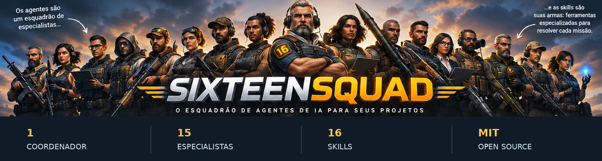
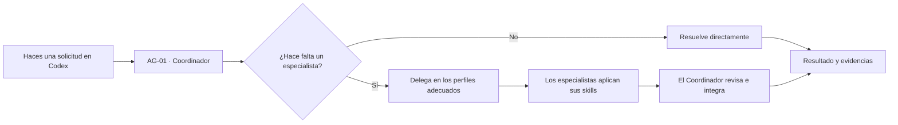

**[Português (Brasil)](README.md) · [English](README.en.md) · Español**

<a id="inicio"></a>

<p align="center">
  
</p>

<h1 align="center">SixteenSquad</h1>

<p align="center"><strong>Tu proyecto. Una misión. Dieciséis especialidades.</strong></p>

<p align="center">
  Un equipo reutilizable para proyectos con <strong>Codex</strong>: <strong>1 Coordinador, 15 especialistas y 16 skills</strong>.
  Tú haces tus solicitudes de forma habitual. El Coordinador decide cuándo trabajar directamente y cuándo recurrir a los especialistas.
</p>

<p align="center">
  <a href="LICENSE"></a>
  <a href="https://github.com/Adriano-Medeiros/SixteenSquad/stargazers"></a>
  
</p>

<p align="center">
  <a href="#por-que-existe"><strong>¿Por qué existe?</strong></a> ·
  <a href="#como-usarlo"><strong>Cómo usarlo</strong></a> ·
  <a href="#instalacion">Instalación</a> ·
  <a href="#como-funciona">Cómo funciona</a> ·
  <a href="#cuota-y-creditos">Cuota y créditos</a> ·
  <a href="#modelos-y-esfuerzo">Modelos y esfuerzo</a> ·
  <a href="#el-escuadron">Conoce al escuadrón</a> ·
  <a href="#documentacion">Documentación</a>
</p>

---

<a id="por-que-existe"></a>

## 01 / ¿Por qué nació SixteenSquad?

**SixteenSquad nació para ayudar a quienes empiezan un proyecto con Codex y tienen dificultades para comprender cómo trabajan los subagentes, cuándo utilizarlos y cómo combinar sus skills.**

Al comenzar a desarrollar con IA surgen muchas preguntas: ¿debo crear un agente para cada área? ¿Cómo delego? ¿Cómo colaboran los especialistas? ¿Cuándo conviene usar una skill? ¿Quién comprueba los resultados?

SixteenSquad ofrece un **punto de partida listo para usar y fácil de entender**. En lugar de construir cada perfil y cada instrucción desde cero, colocas la base en tu proyecto y empiezas a trabajar. El sistema utiliza las capacidades nativas de Codex, dentro de los permisos y limitaciones de tu sesión. **No necesitas contratar una API de IA independiente solo para instalar o utilizar el Starter:** al iniciar sesión en Codex con tu cuenta de ChatGPT, las actividades utilizan la cuota o modalidad de facturación de tu plan (consulta [cuota y créditos](#cuota-y-creditos)).

> **La metáfora del escuadrón:** los mercenarios de la ilustración representan a los **agentes especializados**; las armas y los equipos representan sus **skills**, es decir, herramientas y procedimientos para cada misión. Es una metáfora visual, no una función militar del software. El Coordinador no necesita movilizar a todo el equipo: recurre solo a quienes pueden ayudar con la solicitud.

<a id="como-usarlo"></a>

## 02 / ¿Cómo se usa? Es más sencillo de lo que parece.

**No necesitas memorizar nombres de agentes, aprender comandos de delegación ni llamar manualmente a 16 especialistas.**

1. **Coloca los archivos de SixteenSquad en tu carpeta de trabajo.** Copia `AGENTS.md`, `.codex/agents/`, `.agents/skills/` y `templates/` desde [`starter/`](starter/) a la **raíz** de tu proyecto, o utiliza uno de los métodos de instalación que aparecen a continuación. Conserva los archivos existentes y resuelve los conflictos antes de copiar.
2. **Abre esa carpeta como proyecto en Codex.** En la aplicación de escritorio de Codex, selecciona la carpeta de trabajo que contiene `AGENTS.md`. Después de añadir componentes, inicia una conversación nueva; si es necesario, vuelve a abrir la sesión para que se detecten.
3. **Haz tus solicitudes normalmente, en lenguaje natural.** **AG-01 — Coordinador** recibe la petición, comprende la tarea y puede recurrir a los especialistas y skills adecuados cuando realmente aporten valor. Después integra sus respuestas e informa sobre los resultados, las pruebas, las limitaciones y los asuntos pendientes.

Por ejemplo, puedes escribir simplemente en Codex:

```text
Quiero crear un sistema de registro de clientes. Empieza por la estructura del
proyecto, implementa el registro y comprueba la seguridad y calidad del resultado.
```

La solicitud no necesita mencionar a un especialista por su nombre. Para un cambio sencillo, el Coordinador puede trabajar por su cuenta. Si es necesario, puede implicar a Arquitectura, Backend, Calidad o Seguridad. **La delegación efectiva depende de que los perfiles estén disponibles en tu sesión de Codex**, y tú sigues controlando las autorizaciones y modificaciones del proyecto.

<a id="instalacion"></a>

## 03 / Instalación

El Starter es una base **local que se instala por proyecto**. No requiere servidor propio, base de datos ni instalación global de SixteenSquad.

### Opción A — Instalar en el proyecto actual (`npx`)

Abre PowerShell en la carpeta del proyecto y ejecuta:

```powershell
npx sixteensquad@latest install starter
```

### Opción B — Instalar indicando la ruta (`npx`)

```powershell
npx sixteensquad@latest install starter "C:\MEU_PROJETO"
```

> **Ya disponible:** [`sixteensquad@0.1.0`](https://www.npmjs.com/package/sixteensquad) está publicado en npm. Ambos métodos se probaron en Windows: desde la carpeta actual y con una ruta de destino explícita. Se requieren **Node.js y npm**. La CLI muestra los archivos y solicita confirmación antes de copiarlos.

### Opción C — Instalador PowerShell publicado (sin Node.js)

El [instalador PowerShell](installer/install.ps1) está disponible. Identifica una revisión concreta del paquete, muestra los archivos, solicita confirmación y rechaza los conflictos. Su conjunto de pruebas locales pasó correctamente; la ejecución remota de extremo a extremo todavía debe comprobarse en un entorno con acceso a la red.

<details>
<summary><strong>Mostrar el comando PowerShell publicado con verificación SHA-256</strong></summary>

Copia el comando completo en PowerShell 5.1 o posterior. El SHA-256 del instalador se comprueba antes de ejecutarlo:

```powershell
& { param([string]$ProjectPath,[switch]$Preview) $url='https://raw.githubusercontent.com/Adriano-Medeiros/SixteenSquad/7c52a75cfe0874fb8745c88654d63c7a7e3b52cc/installer/install.ps1'; $sha='E9936D6BFE025464EB90AD7AE57C40BCA20D8B376CADD96870739EEE621970C3'; $file=Join-Path ([IO.Path]::GetTempPath()) ('sixteensquad-install-'+[guid]::NewGuid().ToString('N')+'.ps1'); try { [Net.ServicePointManager]::SecurityProtocol=[Net.SecurityProtocolType]::Tls12; Invoke-WebRequest -UseBasicParsing -Uri $url -OutFile $file; if ((Get-FileHash -LiteralPath $file -Algorithm SHA256).Hash -ne $sha) { throw 'SHA-256 do instalador não confere; execução cancelada.' }; & $file -ProjectPath $ProjectPath -Preview:$Preview } finally { Remove-Item -LiteralPath $file -Force -ErrorAction SilentlyContinue } }
```

[Ver código](installer/install.ps1) · [Ver pruebas](installer/tests/install.tests.ps1)

</details>

### Opción D — Copiar manualmente (disponible ahora)

Abre la carpeta [`starter/`](starter/) del repositorio, descarga los archivos y copia su **contenido interno** a la raíz de tu proyecto. Incluye los directorios ocultos `.codex/` y `.agents/`, y respeta la configuración del proyecto de destino.

**Después de instalar mediante cualquier método:** abre la carpeta de destino en Codex e inicia una conversación nueva. **Solo tienes que hacer tus solicitudes normalmente.** No necesitas configurar una clave de API en SixteenSquad cuando utilizas Codex con tu cuenta de ChatGPT.

<a id="como-funciona"></a>

## 04 / Cómo trabaja el escuadrón



El Coordinador trabaja en la conversación principal. Los otros 15 roles son perfiles de subagentes descritos en archivos TOML. Las 16 skills son procedimientos reutilizables definidos en archivos `SKILL.md`. Cuando resulta útil, los especialistas pueden analizar partes independientes de una tarea en paralelo, sin cambiar los permisos de Codex ni sustituir tus decisiones.

**Importante:** SixteenSquad **no es un orquestador independiente ni un servicio autónomo separado de Codex**. Es un conjunto de instrucciones, perfiles y skills que aprovecha las capacidades disponibles en la aplicación Codex. Instalar los archivos no garantiza que se invoque automáticamente a todos los agentes en cada sesión.

<a id="cuota-y-creditos"></a>

## 05 / ¿Necesito comprar créditos para utilizar SixteenSquad?

**No necesitas comprar créditos de API ni contratar otro servicio de IA solo para utilizar SixteenSquad con Codex.** SixteenSquad es un conjunto de archivos, perfiles y skills; no ofrece un modelo de IA propio, no vende créditos y no realiza cobros.

Cuando **inicias sesión en Codex con tu cuenta de ChatGPT**, el Coordinador y los subagentes utilizan la **cuota de Codex incluida en tu plan**, sujeta a los límites y condiciones aplicables a tu cuenta. No necesitas una clave de la API de OpenAI para este método de acceso.

| Situación | Qué sucede |
|---|---|
| Instalas los archivos de SixteenSquad | La instalación o copia de archivos, por sí sola, no consume uso de IA. |
| Pides una tarea al Coordinador en Codex | La ejecución utiliza la cuota de Codex disponible en tu plan. |
| El Coordinador recurre a otros subagentes | **Su trabajo también consume la cuota**; más agentes, contextos largos, modelos exigentes y mayor esfuerzo de razonamiento pueden agotarla antes. |
| Se agota tu cuota | Codex informa sobre los límites y las alternativas de tu cuenta. Quizás debas esperar a la renovación o, si la opción está disponible y lo deseas, adquirir créditos adicionales. |
| Accedes a Codex con una **clave de API** en lugar de tu cuenta de ChatGPT | El uso sigue una **facturación independiente de la API**; no debe confundirse con la cuota incluida en la suscripción de ChatGPT. |

**En resumen:** SixteenSquad **no genera cargos adicionales por agente o skill**, pero las tareas realizadas por los agentes **no son ilimitadas**. El consumo corresponde a Codex y depende del plan, los modelos elegidos, la complejidad de las tareas y la configuración. En planes que comparten cuota con otras funciones, como ChatGPT Work, utilizarlas también puede afectar al saldo disponible.

**Cómo consultar el uso:** abre **Configuración → Uso** en Codex/ChatGPT para revisar tu cuota y los momentos de renovación. En la CLI de Codex también puedes utilizar `/status` durante una sesión. No necesitas conocer el número de tokens para comenzar: basta con revisar el consumo cuando realices trabajos grandes.

Fuentes oficiales: [Uso de Codex con tu plan de ChatGPT](https://help.openai.com/en/articles/11369540-using-codex-with-your-chatgpt-plan) · [Cómo funcionan los créditos adicionales](https://help.openai.com/en/articles/12642688-using-credits-for-flexible-usage-in-chatgpt-personal-plans) · [Modelos, límites y uso en Work/Codex](https://help.openai.com/en/articles/20001516-managing-usage-with-gpt-6-astra-in-work-and-codex).

<a id="modelos-y-esfuerzo"></a>

## 06 / ¿Qué modelo de IA utiliza SixteenSquad? ¿Y qué esfuerzo de razonamiento?

**SixteenSquad no tiene un modelo de IA propio.** Utiliza los modelos disponibles en **tu sesión de Codex**. El Starter aporta los roles, las instrucciones y las skills; quien realiza el razonamiento es el modelo de IA configurado en Codex.

### Configuración actual del Starter

| Quién trabaja | Modelo de IA | Esfuerzo de razonamiento |
|---|---|---|
| **AG-01 · Coordinador** | Modelo seleccionado en la sesión de Codex | Esfuerzo seleccionado en la sesión |
| **14 especialistas** (AG-02 a AG-14 y AG-16) | Siguen la configuración efectiva de subagentes de Codex | Siguen la configuración efectiva de esfuerzo de subagentes |
| **AG-15 · Documentación** | `gpt-6-luna` (definido en su TOML) | `high` (definido en su TOML) |
| **16 skills** | **No tienen modelo propio** | Son instrucciones utilizadas por el modelo con el que trabaja cada agente |

> **Importante:** los 14 especialistas sin configuración propia normalmente heredan el modelo y el esfuerzo de la sesión principal. Si configuraste valores generales de subagentes en Codex o especificaste ajustes al crear un subagente, estos pueden tener prioridad. AG-15, en cambio, tiene valores explícitos en su archivo y **no cambia automáticamente al modelo elegido para el Coordinador**. En pruebas locales anteriores, la sesión principal utilizó `gpt-6-astra` con esfuerzo `high`; era una **configuración de prueba, no un requisito del Starter**.

### ¿Qué modelos de IA puedo elegir? (`model`)

El campo `model` acepta el **identificador exacto** de un modelo reconocido por tu instalación de Codex. La siguiente tabla presenta algunos modelos principales documentados por OpenAI a fecha de **28 de octubre de 2026**. Es una referencia inicial, **no una lista exhaustiva ni una garantía de acceso desde tu cuenta**.

| Valor de `model` | Perfil y aplicación sugerida | Ejemplos de roles del escuadrón |
|---|---|---|
| `gpt-6-astra` | Modelo robusto para decisiones complejas, arquitectura, análisis de riesgos y tareas difíciles | Coordinador, Arquitecto, Seguridad, Auditoría |
| `gpt-6.1-sol` | Buen equilibrio para desarrollo, tareas largas y trabajo en varias etapas | Coordinador, Backend, Frontend, Calidad |
| `gpt-6.1-terra` | Modelo eficiente para redacción, interpretación de interfaces y trabajo visual | UX/UI, Documentación, Accesibilidad |
| `gpt-6-luna` | Modelo ligero para tareas concretas, análisis rápido y trabajos repetitivos | Documentación, Git, comprobaciones delimitadas |

**Los modelos disponibles cambian con el tiempo.** Algunos anteriores, como `gpt-6-sol`, pueden aparecer en entornos donde aún se ofrecen. Que un modelo figure en la documentación de la API **no garantiza** que pueda utilizarse como subagente en tu sesión de Codex.

**Cómo consultar tus modelos:** abre el selector de modelos de **Codex** y revisa las opciones de tu cuenta. En la CLI de Codex, `/model` muestra el catálogo y los niveles de esfuerzo disponibles en ese entorno. Elige únicamente identificadores a los que realmente tengas acceso. Si aparece un error de modelo no disponible, elimina la configuración personalizada del TOML y utiliza la herencia de la sesión hasta elegir uno compatible.

### ¿Qué niveles de esfuerzo puedo elegir? (`model_reasoning_effort`)

El campo `model_reasoning_effort` regula la profundidad del razonamiento. Un valor mayor normalmente implica más tiempo y consumo de recursos; la mejor opción depende de la tarea. Estos nombres son **valores de configuración**, no nombres de skills.

| Valor | Significado práctico | Cuándo considerarlo |
|---|---|---|
| `none` | Sin esfuerzo adicional de razonamiento | Tareas muy simples; **solo en modelos y clientes que lo admitan** |
| `low` | Esfuerzo bajo (Light en algunas interfaces) | Consultas y cambios pequeños |
| `medium` | Esfuerzo intermedio | Trabajo cotidiano e implementaciones habituales |
| `high` | Razonamiento más profundo | Revisiones, depuración y arquitectura |
| `xhigh` | Extra High | Problemas difíciles y análisis extensos |
| `max` | Máximo esfuerzo disponible para una tarea individual | Cuestiones excepcionalmente complejas, cuando esté disponible |
| `ultra` | Modo especial de razonamiento/delegación, cuando Codex lo ofrezca | Trabajo complejo divisible entre subagentes; **se recomienda activarlo desde el selector de la aplicación** |

**Compatibilidad de niveles:** los valores admitidos dependen del modelo y de la versión del cliente Codex. La documentación oficial muestra ejemplos de `gpt-6-astra` con `low`, `gpt-6.1-sol` con niveles seleccionados en el cliente y `gpt-6-luna` con `high`. Para **Max** y **Ultra**, consulta el selector de Codex. **Ultra** utiliza subagentes y no equivale a un nivel ordinario de razonamiento; Luna no ofrece Ultra. No supongas que todos los modelos admiten todas las combinaciones anteriores.

**Cómo comprobarlo:** en la CLI de Codex, usa `/model` para consultar los niveles ofrecidos; en la aplicación de escritorio, utiliza el selector de modelo y esfuerzo. SixteenSquad no requiere una combinación universal.

### Ejemplos TOML listos para copiar

Para una tarea de arquitectura compleja:

```toml
model = "gpt-6-astra"
model_reasoning_effort = "high"
```

Para tareas de documentación bien delimitadas (si deseas cambiar el valor actual de AG-15):

```toml
model = "gpt-6-luna"
model_reasoning_effort = "medium"
```

**No sustituyas todo el perfil del agente por estas dos líneas.** Debes agregarlas o modificarlas dentro de `.codex/agents/<nombre-del-agente>.toml`, conservando los campos `name`, `description` y `developer_instructions`. Por defecto, AG-15 utiliza `gpt-6-luna` con `high`; los demás especialistas no fijan su modelo ni su esfuerzo. Al eliminar los dos ajustes personalizados, el perfil vuelve a seguir la configuración efectiva de Codex, de acuerdo con las reglas de herencia y la configuración general.

Referencias consultadas el 28 de octubre de 2026: [Modelos en Codex](https://learn.chatgpt.com/docs/models) · [Subagentes: selección y herencia](https://learn.chatgpt.com/docs/agent-configuration/subagents) · [Configuración de Codex](https://learn.chatgpt.com/docs/config-file/config-reference) · [Catálogo de modelos OpenAI](https://developers.openai.com/api/docs/models).

### Cómo cambiar el modelo o el esfuerzo de razonamiento

**1. Para el Coordinador y los especialistas que siguen su configuración:**

Abre el proyecto en la **aplicación de escritorio Codex** y utiliza los selectores de **modelo** y **esfuerzo de razonamiento** de la conversación, si están disponibles. Inicia una conversación nueva con las opciones elegidas. Los perfiles sin valores propios suelen seguir esa elección, respetando los ajustes generales de subagentes que tengas configurados en Codex.

**2. Para definir valores específicos de un especialista:**

Edita el archivo TOML correspondiente en la carpeta `.codex/agents/` de **tu proyecto**. Por ejemplo, AG-15 está configurado en [`ag15_documentation.toml`](starter/.codex/agents/ag15_documentation.toml) con estas líneas:

```toml
model = "gpt-6-luna"
model_reasoning_effort = "high"
```

Para elegir otro modelo o esfuerzo, cambia los valores por opciones **compatibles con Codex y disponibles para tu cuenta**. También puedes añadir esas dos líneas al TOML de otro especialista, por ejemplo `.codex/agents/ag08_quality.toml`, si quieres una configuración exclusiva para Calidad. Conserva `name`, `description` y `developer_instructions`.

Para que **AG-15 vuelva a seguir la configuración general**, elimina **ambas líneas** (`model` y `model_reasoning_effort`) de su TOML. Después de editar los archivos, inicia una conversación nueva y, si es necesario, vuelve a abrir el proyecto en Codex. Si el perfil no se reconoce, informa de ello antes de afirmar que utilizó el nuevo modelo.

**3. Para establecer valores comunes para todos los subagentes:**

Los usuarios avanzados pueden configurar `default_subagent_model` y `default_subagent_reasoning_effort` dentro de `[agents]` en los ajustes de Codex. No es necesario hacerlo para empezar; SixteenSquad **no modifica automáticamente la configuración global**.

> **Tú eliges los modelos:** no es necesario cambiar los textos de las skills (`SKILL.md`) para cambiar la IA. El modelo determina *quién* realiza la tarea; la skill orienta *cómo* realizarla. El Starter no garantiza que cualquier modelo solicitado esté habilitado en tu cuenta ni demuestra la identidad interna del modelo servido solo porque aparezca en el archivo TOML.

Documentación oficial: [Subagentes y prioridad de configuración](https://learn.chatgpt.com/docs/agent-configuration/subagents) · [Referencia de configuración de Codex](https://learn.chatgpt.com/docs/config-file/config-reference).

<a id="el-escuadron"></a>

## 07 / Conoce a los 16 integrantes del escuadrón

En el lenguaje visual del proyecto, cada especialista tiene un equipo simbólico: un fusil para la construcción, dos pistolas para las interfaces, una ametralladora para operaciones, un lanzador para escenas 3D, una radio para comunicación y otros elementos. **En la práctica, la especialidad la definen el perfil y la skill, no las armas de la ilustración.**

| Integrante | Especialidad real | Equipo en la metáfora | Skill principal |
|---|---|---|---|
| **AG-01 · Comandante** | Coordinador | Radio de mando y mapa táctico | `ss-coordinate` |
| **AG-02 · Operador de rutas** | Git Manager | Rastreador de rutas y kit de operaciones | `ss-git-governance` |
| **AG-03 · Estratega** | Arquitecto de Software | Mapas, planos y prismáticos | `ss-architecture` |
| **AG-04 · Asalto** | Backend Developer | Fusil de asalto | `ss-backend-api` |
| **AG-05 · Dos frentes** | Frontend Developer | Dos pistolas | `ss-frontend-states` |
| **AG-06 · Artillería** | 3D Developer | Lanzacohetes de utilería | `ss-3d-scene` |
| **AG-07 · Operador de conexiones** | Data Integration | Cables y enlaces de comunicación | `ss-data-mapping` |
| **AG-08 · Tirador de precisión** | Quality Engineer | Mira de precisión e instrumentos de prueba | `ss-quality-checks` |
| **AG-09 · Guardián** | Security Engineer | Escudo táctico | `ss-threat-review` |
| **AG-10 · Armas de apoyo** | DevOps Engineer | Ametralladora de utilería y kit de suministros | `ss-delivery-recovery` |
| **AG-11 · Investigador** | Technical Auditor | Visor de inspección y rastreador | `ss-technical-audit` |
| **AG-12 · Especialista de campo** | UX/UI Specialist | Kit de reconocimiento y observación | `ss-ux-flow` |
| **AG-13 · Guardián de datos** | Database Specialist | Caja fuerte blindada | `ss-data-integrity` |
| **AG-14 · Explorador veloz** | Performance Specialist | Equipo de movilidad | `ss-performance-analysis` |
| **AG-15 · Comunicador** | Technical Documentation | Radio y terminal de comunicación | `ss-technical-docs` |
| **AG-16 · Apoyo universal** | Accessibility Specialist | Equipos de apoyo y acceso | `ss-accessibility-review` |

Esta tabla es una **propuesta de identidad visual**, no un cambio en las responsabilidades de los agentes. Las especialidades, perfiles y skills reales están publicados en el [Starter](starter/README.md).

<a id="ejemplos"></a>

## 08 / Solicitudes que puedes hacer normalmente

**Construcción:**

```text
Crea una API de registro de clientes con validación de datos y pruebas.
```

**Calidad y seguridad:**

```text
Revisa este módulo, identifica riesgos y propone correcciones prioritarias.
```

**Interfaz:**

```text
Mejora esta pantalla para móviles, incluyendo estados de error y accesibilidad.
```

**Trabajo multidisciplinario:**

```text
Planifica e implementa el registro de productos. Organiza el trabajo entre
los especialistas necesarios e informa de lo que se haya verificado.
```

**Puedes** solicitar un especialista por su nombre cuando quieras, pero no es obligatorio para el uso cotidiano.

## 09 / ¿Qué se instala en tu proyecto?

```text
tu-proyecto/
├── AGENTS.md                  # AG-01: instrucciones del Coordinador
├── .codex/
│   └── agents/                # AG-02 a AG-16: 15 perfiles TOML
├── .agents/
│   └── skills/                # 16 skills con SKILL.md
└── templates/
    ├── SPEC.md
    ├── PLAN.md
    └── TASK.md
```

Los instaladores `npx` y PowerShell seleccionan **35 archivos**. Los templates son opcionales y editables; no hacen obligatorio seguir SPEC, PLAN y TASK para cada solicitud. El proyecto receptor sigue siendo dueño de su código, configuraciones y aprobaciones.

## 10 / Seguridad, pruebas y limitaciones

El Starter se probó en otro proyecto receptor, con evidencias de invocación nativa de **AG-15** y lectura de su skill. Durante las pruebas de desarrollo, los especialistas **AG-08** y **AG-09** trabajaron en sesiones simultáneas. Eso **no** demuestra el funcionamiento completo de los 16 perfiles.

El validador del Starter devolvió `ok: true` para **15 perfiles, 16 skills, 73 enlaces locales y cero errores**. La batería del Starter ejecutó **41 pruebas**, con resultados satisfactorios y algunas omisiones por las restricciones de enlaces en Windows. El instalador PowerShell pasó **21 pruebas sintéticas**. En la CLI npm v0.1.0, **9 pruebas pasaron y 1 se omitió** por falta de permisos para crear enlaces simbólicos. El paquete incluyó los 35 archivos; las instalaciones públicas en la carpeta actual y en una ruta personalizada se realizaron correctamente. Al repetir la instalación, se reconocieron los archivos idénticos sin sobrescribirlos. Las limitaciones completas aparecen en el [README del Starter](starter/README.md#validação-e-limitações-locais) (en portugués).

No confundas archivos instalados con delegación comprobada. Codex debe reconocer los perfiles y skills en la sesión; los permisos y los modelos disponibles pueden variar. La instalación no autoriza automáticamente commits, publicaciones ni otras acciones sensibles.

<a id="documentacion"></a>

## 11 / Documentación

| Contenido | Referencia |
|---|---|
| Guía de uso y especialidades | [starter/README.md](starter/README.md) |
| Instrucciones del Coordinador | [starter/AGENTS.md](starter/AGENTS.md) |
| Perfiles TOML | [starter/.codex/agents/](starter/.codex/agents/) |
| Biblioteca de skills | [starter/.agents/skills/](starter/.agents/skills/) |
| Templates SPEC / PLAN / TASK | [starter/templates/](starter/templates/) |
| Registro de validación | [starter/VALIDATION.md](starter/VALIDATION.md) |
| CLI npm (versión publicada) | [sixteensquad en npm](https://www.npmjs.com/package/sixteensquad) |
| Instalador PowerShell y pruebas | [installer/](installer/) |
| Licencia | [LICENSE](LICENSE) |

*Actualmente, las guías técnicas detalladas del Starter se mantienen en portugués de Brasil. Esta página es la versión en español de la presentación general del proyecto.*

## 12 / Comunidad

SixteenSquad es un proyecto **de código abierto** publicado bajo la [licencia MIT](LICENSE). Puedes estudiarlo, adaptarlo, proponer mejoras y contribuir respetando la licencia.

[Dar una estrella](https://github.com/Adriano-Medeiros/SixteenSquad/stargazers) · [Informar de un problema](https://github.com/Adriano-Medeiros/SixteenSquad/issues) · [Proponer una mejora](https://github.com/Adriano-Medeiros/SixteenSquad/pulls)

<p align="center"><strong>SixteenSquad — tú defines la misión. El Coordinador reúne al escuadrón.</strong><br /><a href="#inicio">Volver al inicio ↑</a></p>
