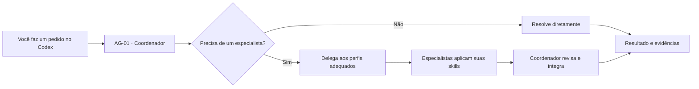

**Português (Brasil) · [English](README.en.md) · [Español](README.es.md)**

<a id="topo"></a>

<p align="center">
  
</p>

<h1 align="center">SixteenSquad</h1>

<p align="center"><strong>Seu projeto. Uma missão. Dezesseis especialidades.</strong></p>

<p align="center">
  Uma equipe reutilizável para projetos no <strong>Codex</strong>: <strong>1 Coordenador, 15 especialistas e 16 skills</strong>.
  Você faz os pedidos normalmente. O Coordenador decide quando trabalhar diretamente e quando envolver especialistas.
</p>

<p align="center">
  <a href="LICENSE"></a>
  <a href="https://github.com/Adriano-Medeiros/SixteenSquad/stargazers"></a>
  
</p>

<p align="center">
  <a href="#por-que-existe"><strong>Por que existe?</strong></a> ·
  <a href="#como-usar"><strong>Como usar</strong></a> ·
  <a href="#instalacao">Instalação</a> ·
  <a href="#como-funciona">Como funciona</a> ·
  <a href="#franquia-e-creditos">Franquia e créditos</a> ·
  <a href="#modelos-e-esforco">Modelos e esforço</a> ·
  <a href="#esquadrao">Conheça o esquadrão</a> ·
  <a href="#documentacao">Documentação</a>
</p>

---

<a id="por-que-existe"></a>

## 01 / Por que o SixteenSquad nasceu?

**O SixteenSquad nasceu para ajudar quem está iniciando um projeto com o Codex e encontra dificuldades para entender como os subagentes trabalham, quando usá-los e como combinar suas skills.**

Quando alguém começa a desenvolver com IA, surgem muitas perguntas: preciso criar um agente para cada área? Como delegar? Como fazer especialistas cooperarem? Quando usar uma skill? Quem confere os resultados?

A proposta do SixteenSquad é oferecer um **ponto de partida pronto e compreensível**. Em vez de montar cada perfil e cada instrução do zero, você coloca a base no seu projeto e começa a trabalhar. O sistema utiliza os recursos nativos do Codex, dentro das permissões e limitações da sessão. **Você não precisa contratar uma API de IA só para instalar ou usar o Starter:** ao entrar no Codex com sua conta ChatGPT, as atividades usam a franquia ou a modalidade de cobrança do seu plano (veja [franquia e créditos](#franquia-e-creditos)).

> **A ideia do esquadrão:** os mercenários da ilustração representam os **agentes especializados**; as armas e equipamentos representam suas **skills** — ferramentas e procedimentos para cada missão. É uma metáfora visual, não um recurso militar do software. O Coordenador não precisa mobilizar todo o time: chama apenas quem pode ajudar no pedido.

<a id="como-usar"></a>

## 02 / Como usar? É mais simples do que parece.

**Você não precisa decorar nomes de agentes, aprender comandos de delegação nem chamar 16 especialistas manualmente.**

1. **Coloque os arquivos do SixteenSquad na pasta de trabalho.** Copie `AGENTS.md`, `.codex/agents/`, `.agents/skills/` e `templates/` da pasta [`starter/`](starter/) para a **raiz** do seu projeto, ou use uma das opções de instalação abaixo. Preserve arquivos existentes e resolva conflitos antes de copiar.
2. **Abra essa pasta como projeto no Codex.** No aplicativo Codex, selecione a pasta de trabalho que contém `AGENTS.md`. Para componentes recém-adicionados, inicie uma nova conversa; se necessário, reabra a sessão para que sejam descobertos.
3. **Faça seus pedidos normalmente, em linguagem natural.** O **AG-01 — Coordenador** recebe a solicitação, entende a tarefa e pode chamar os especialistas e skills adequados quando isso realmente trouxer benefício. Depois integra as respostas e informa resultados, testes, limites e pendências.

Por exemplo, você pode simplesmente escrever no Codex:

```text
Quero criar um sistema de cadastro de clientes. Comece pela estrutura do projeto,
implemente o cadastro e verifique a segurança e a qualidade do resultado.
```

O pedido não precisa citar o nome do especialista. Para uma mudança simples, o Coordenador pode trabalhar sozinho. Se houver necessidade, pode envolver Arquitetura, Backend, Qualidade ou Segurança. **A delegação efetiva depende de os perfis estarem disponíveis na sessão do Codex**, e o usuário continua controlando autorizações e alterações no projeto.

<a id="instalacao"></a>

## 03 / Instalação

O Starter é uma base **local, instalada por projeto**. Ele não exige servidor próprio, banco de dados ou instalação global do SixteenSquad.

### Opção A — Instalar dentro do projeto atual (`npx`)

Abra o PowerShell na pasta do projeto e execute:

```powershell
npx sixteensquad@latest install starter
```

### Opção B — Instalar indicando o caminho (`npx`)

```powershell
npx sixteensquad@latest install starter "C:\MEU_PROJETO"
```

> **Disponível:** o pacote [`sixteensquad@0.1.0`](https://www.npmjs.com/package/sixteensquad) foi publicado no npm. As duas formas de instalação foram testadas no Windows: na pasta atual e em caminho personalizado. Requer **Node.js e npm**. A CLI mostra os arquivos e solicita confirmação antes de copiar.

### Opção C — Instalador PowerShell já publicado (sem Node.js)

O [instalador PowerShell](installer/install.ps1) está disponível. Ele identifica uma versão do pacote, apresenta os arquivos, solicita confirmação e recusa conflitos. Sua suíte passou por testes locais; a execução remota de ponta a ponta ainda precisa ser comprovada em um ambiente com rede.

<details>
<summary><strong>Mostrar comando PowerShell publicado com verificação SHA-256</strong></summary>

Copie o comando completo no PowerShell 5.1 ou posterior. A conferência do SHA-256 ocorre antes da execução do instalador:

```powershell
& { param([string]$ProjectPath,[switch]$Preview) $url='https://raw.githubusercontent.com/Adriano-Medeiros/SixteenSquad/7c52a75cfe0874fb8745c88654d63c7a7e3b52cc/installer/install.ps1'; $sha='E9936D6BFE025464EB90AD7AE57C40BCA20D8B376CADD96870739EEE621970C3'; $file=Join-Path ([IO.Path]::GetTempPath()) ('sixteensquad-install-'+[guid]::NewGuid().ToString('N')+'.ps1'); try { [Net.ServicePointManager]::SecurityProtocol=[Net.SecurityProtocolType]::Tls12; Invoke-WebRequest -UseBasicParsing -Uri $url -OutFile $file; if ((Get-FileHash -LiteralPath $file -Algorithm SHA256).Hash -ne $sha) { throw 'SHA-256 do instalador não confere; execução cancelada.' }; & $file -ProjectPath $ProjectPath -Preview:$Preview } finally { Remove-Item -LiteralPath $file -Force -ErrorAction SilentlyContinue } }
```

[Ver código](installer/install.ps1) · [Ver testes](installer/tests/install.tests.ps1)

</details>

### Opção D — Copiar manualmente (disponível agora)

Abra a pasta [`starter/`](starter/) no repositório, obtenha os arquivos e copie o **conteúdo interno** para a raiz do seu projeto. Inclua as pastas ocultas `.codex/` e `.agents/` e preserve as configurações do projeto receptor.

**Depois de instalar por qualquer método:** abra a pasta receptora no Codex e comece uma nova conversa. **É só fazer seus pedidos normalmente.** Você não precisa cadastrar chave de API no SixteenSquad quando utiliza o Codex autenticado com sua conta ChatGPT.

<a id="como-funciona"></a>

## 04 / Como o esquadrão trabalha



O Coordenador atua na conversa principal. Os outros quinze papéis são perfis de subagentes descritos em arquivos TOML. As dezesseis skills são procedimentos reutilizáveis em `SKILL.md`. Quando útil, os especialistas podem analisar partes independentes em paralelo, sem alterar as permissões do Codex nem substituir as decisões do usuário.

**Importante:** o SixteenSquad **não é um orquestrador ou serviço autônomo separado do Codex**. É um conjunto de instruções, perfis e skills para aproveitar os recursos que o aplicativo disponibiliza. Instalar arquivos não garante que todos sejam automaticamente acionados em toda sessão.

<a id="franquia-e-creditos"></a>

## 05 / Preciso comprar créditos para usar o SixteenSquad?

**Não é necessário comprar créditos de API nem contratar um serviço de IA separado só para usar o SixteenSquad com o Codex.** O SixteenSquad é um conjunto de arquivos, perfis e skills; ele não fornece um modelo de IA, não vende créditos e não realiza cobranças próprias.

Quando você **entra no Codex com sua conta do ChatGPT**, o Coordenador e os subagentes utilizam a **franquia de uso do Codex incluída no seu plano**, sujeita aos limites e às regras aplicáveis à sua conta. Não é preciso informar uma chave de API da OpenAI para esse modo de acesso.

| Situação | O que acontece |
|---|---|
| Você instala os arquivos do SixteenSquad | Não há consumo de IA pela simples instalação ou cópia dos arquivos. |
| Você pede uma tarefa ao Coordenador no Codex | A execução utiliza a franquia de Codex disponível em seu plano. |
| O Coordenador aciona outros subagentes | O trabalho deles **também consome** a franquia; mais agentes, contextos extensos, modelos exigentes e esforços elevados podem esgotá-la mais rapidamente. |
| Sua franquia termina | O Codex informa os limites e as alternativas da sua conta. Você poderá precisar aguardar a renovação ou, se houver suporte e você optar por isso, adquirir créditos adicionais. |
| Você entra no Codex por **chave de API**, em vez de usar sua conta ChatGPT | A utilização segue a **cobrança separada da API**; não confunda esse modo com a franquia da assinatura ChatGPT. |

**Em resumo:** usar o SixteenSquad **não cria uma cobrança extra por agente ou por skill**, mas as tarefas executadas pelos agentes **não são ilimitadas**. O consumo pertence ao Codex e depende do plano, dos modelos escolhidos, da complexidade das tarefas e das configurações. Nos planos que compartilham franquia com outros recursos, como ChatGPT Work, a utilização dessas ferramentas também pode afetar o saldo disponível.

**Como acompanhar:** abra **Configurações → Uso** no Codex/ChatGPT para conferir sua franquia e os horários de renovação. Na CLI do Codex, você também pode usar `/status` durante uma sessão. Não é preciso conhecer a quantidade de tokens para começar: apenas acompanhe o consumo quando fizer trabalhos maiores.

Fontes oficiais: [Usando o Codex com seu plano ChatGPT](https://help.openai.com/pt-br/articles/11369540-using-codex-with-your-chatgpt-plan) · [Como funcionam os créditos adicionais](https://help.openai.com/pt-br/articles/12642688-using-credits-for-flexible-usage-in-chatgpt-personal-plans) · [Modelos, limites e uso no Work/Codex](https://help.openai.com/pt-br/articles/20001516-managing-usage-with-gpt-6-astra-in-work-and-codex).

<a id="modelos-e-esforco"></a>

## 06 / Qual IA o SixteenSquad usa? E qual é o esforço?

**O SixteenSquad não possui um modelo de IA próprio.** Ele utiliza os modelos disponibilizados na **sua sessão do Codex**. O Starter fornece os papéis, as instruções e as skills; quem executa o raciocínio é o modelo de IA configurado no Codex.

### Configuração atual do Starter

| Quem trabalha | Modelo de IA | Esforço de raciocínio |
|---|---|---|
| **AG-01 · Coordenador** | Modelo selecionado na sessão do Codex | Esforço selecionado na sessão |
| **14 especialistas** (AG-02 a AG-14 e AG-16) | Seguem a configuração efetiva para subagentes do Codex | Seguem a configuração efetiva para subagentes |
| **AG-15 · Documentação** | `gpt-6-luna` (definido no TOML) | `high` (definido no TOML) |
| **16 skills** | **Não têm modelo próprio** | São instruções que o agente executa com o modelo que estiver usando |

> **Importante:** os 14 especialistas sem configuração própria normalmente herdam o modelo e o esforço da sessão principal. Se você configurou valores gerais de subagentes no Codex, ou os definiu ao criar um subagente, esses valores podem prevalecer. Já o AG-15 tem configuração explícita no arquivo e **não passa a usar automaticamente o modelo selecionado para o Coordenador**. Nas verificações locais anteriores, a sessão principal usou `gpt-6-astra` com esforço `high`; isso foi uma **configuração de teste, não uma exigência do Starter**.

### Quais modelos de IA posso escolher? (`model`)

O campo `model` recebe o **identificador exato** de um modelo reconhecido pelo seu Codex. A tabela a seguir apresenta os principais modelos documentados pela OpenAI em **28/10/2026**; é uma referência para começar, **não uma relação exaustiva nem uma garantia de acesso na sua conta**.

| Valor de `model` | Perfil e aplicação sugerida | Exemplo de uso no esquadrão |
|---|---|---|
| `gpt-6-astra` | Modelo mais robusto para decisões complexas, arquitetura, análise de risco e tarefas difíceis | Coordenador, Arquiteto, Segurança, Auditoria |
| `gpt-6.1-sol` | Bom equilíbrio para desenvolvimento, tarefas longas e trabalho com múltiplas etapas | Coordenador, Backend, Frontend, Qualidade |
| `gpt-6.1-terra` | Modelo eficiente para escrita, interpretação de interfaces e trabalho visual | UX/UI, Documentação, Acessibilidade |
| `gpt-6-luna` | Modelo leve para tarefas objetivas, análise rápida e atividades repetitivas | Documentação, Git, verificações delimitadas |

**A lista muda com o tempo.** Alguns modelos anteriores, como `gpt-6-sol`, podem aparecer em ambientes que ainda os disponibilizam. O fato de um modelo aparecer na documentação da API **não garante** que ele possa ser usado como subagente na sua sessão do Codex.

**Como descobrir o que você pode usar:** abra o seletor de modelos do **Codex** e veja as opções oferecidas para sua conta. Se utilizar a CLI do Codex, o comando `/model` mostra o catálogo e os níveis disponibilizados naquele ambiente. Escolha somente identificadores efetivamente disponíveis; se houver erro de modelo indisponível, remova a configuração personalizada do TOML e use a herança da sessão até escolher um modelo compatível.

### Quais níveis de esforço posso escolher? (`model_reasoning_effort`)

O campo `model_reasoning_effort` regula a profundidade do raciocínio. Quanto maior, normalmente maior é o tempo e o consumo de recursos; a melhor escolha depende da tarefa. Os nomes são **valores de configuração**, e não nomes de skills.

| Valor | Significado prático | Quando considerar |
|---|---|---|
| `none` | Sem esforço de raciocínio adicional | Tarefas muito simples; **somente em modelos e clientes que o aceitem** |
| `low` | Baixo esforço (Light em algumas interfaces) | Consultas e mudanças pequenas |
| `medium` | Esforço intermediário | Trabalho cotidiano e implementações comuns |
| `high` | Raciocínio mais aprofundado | Revisões, depuração e arquitetura |
| `xhigh` | Extra High | Problemas difíceis e análises extensas |
| `max` | Máximo esforço disponível para uma tarefa individual | Questões excepcionalmente complexas, quando disponível |
| `ultra` | Modo especial de raciocínio/delegação, quando oferecido pelo Codex | Trabalhos complexos divisíveis entre subagentes; **prefira habilitar pelo seletor do aplicativo** |

**Compatibilidade dos níveis de esforço:** a lista de opções reconhecidas pelo Codex depende do modelo e da versão do cliente. A documentação oficial exemplifica `gpt-6-astra` com `low`, `gpt-6.1-sol` com níveis escolhidos no cliente e `gpt-6-luna` com `high`; para **Max** e **Ultra**, consulte o seletor do Codex. O modo **Ultra** utiliza subagentes e não equivale a um nível comum de raciocínio; o Luna não oferece Ultra. Evite assumir que todas as combinações da tabela anterior são aceitas por todo modelo.

**Como conferir:** no Codex CLI, use `/model` e veja os esforços oferecidos; no aplicativo, utilize o seletor de modelo e esforço. Não existe uma combinação universal obrigatória para o SixteenSquad.

### Exemplos prontos para copiar nos perfis TOML

Um exemplo para uma tarefa complexa de arquitetura:

```toml
model = "gpt-6-astra"
model_reasoning_effort = "high"
```

Um exemplo para tarefas de documentação bem delimitadas (caso queira alterar o padrão atual do AG-15):

```toml
model = "gpt-6-luna"
model_reasoning_effort = "medium"
```

**Não substitua o conteúdo inteiro do perfil por essas duas linhas.** Elas devem ser inseridas ou alteradas no arquivo `.codex/agents/<nome-do-agente>.toml`, preservando `name`, `description` e `developer_instructions`. Por padrão, o AG-15 do Starter usa `gpt-6-luna` com `high`; os demais especialistas não fixam modelo ou esforço. Remover as duas opções personalizadas faz o perfil acompanhar a configuração efetiva do Codex, respeitadas as regras de herança e configuração geral.

Referências consultadas em 28/10/2026: [Modelos no Codex](https://learn.chatgpt.com/docs/models) · [Subagentes: seleção e herança](https://learn.chatgpt.com/docs/agent-configuration/subagents) · [Configuração do Codex](https://learn.chatgpt.com/docs/config-file/config-reference) · [Catálogo de modelos OpenAI](https://developers.openai.com/api/docs/models).

### Como alterar o modelo ou o esforço

**1. Para o Coordenador e os especialistas que o acompanham:**

Abra seu projeto no **aplicativo Codex** e utilize o seletor de **modelo** e de **esforço de raciocínio** da conversa, quando disponíveis. Comece uma nova conversa com as opções desejadas. Os perfis sem valores próprios tendem a acompanhar essa escolha, respeitando eventuais padrões de subagentes configurados no Codex.

**2. Para definir valores específicos para um especialista:**

Edite o arquivo TOML correspondente dentro da pasta `.codex/agents/` do **seu projeto**. Por exemplo, o AG-15 já vem configurado em [`ag15_documentation.toml`](starter/.codex/agents/ag15_documentation.toml) com estas linhas:

```toml
model = "gpt-6-luna"
model_reasoning_effort = "high"
```

Para escolher outro modelo ou esforço, altere esses valores para opções **compatíveis com o Codex e disponíveis para sua conta**. Você também pode adicionar as duas linhas ao TOML de outro especialista, por exemplo em `.codex/agents/ag08_quality.toml`, caso queira uma configuração exclusiva para o agente de Qualidade. Preserve os campos `name`, `description` e `developer_instructions`.

Para fazer o **AG-15 voltar a acompanhar a configuração geral**, remova **as duas linhas** (`model` e `model_reasoning_effort`) de seu TOML. Após editar os arquivos, abra uma nova conversa e, se necessário, reabra o projeto no Codex. Se o perfil não for reconhecido, informe o problema antes de concluir que ele utilizou o novo modelo.

**3. Para usar um padrão comum em todos os subagentes:**

Usuários mais experientes podem configurar os padrões `default_subagent_model` e `default_subagent_reasoning_effort` na seção `[agents]` das configurações do Codex. Não é necessário fazer isso para começar; o SixteenSquad **não altera sua configuração global automaticamente**.

> **Modelos são escolhas suas:** não há necessidade de alterar os textos das skills (`SKILL.md`) para trocar a IA. O modelo define quem executa a tarefa; a skill orienta *como* executá-la. O Starter não garante que qualquer modelo solicitado esteja habilitado na conta nem comprova a identidade interna do modelo servido apenas pela presença do TOML.

Documentação oficial: [Subagentes e prioridade de configuração](https://learn.chatgpt.com/docs/agent-configuration/subagents) · [Referência de configuração do Codex](https://learn.chatgpt.com/docs/config-file/config-reference).

<a id="esquadrao"></a>

## 07 / Conheça os 16 integrantes

Na linguagem visual do projeto, cada especialista tem um equipamento simbólico: um fuzil para construção, pistolas para interface, uma metralhadora para operações, um lançador para cenas 3D, rádio para comunicação e assim por diante. **Na prática, a especialidade é definida pelo perfil e pela skill, não pela arma da ilustração.**

| Integrante | Especialidade real | Equipamento na metáfora | Skill principal |
|---|---|---|---|
| **AG-01 · Comandante** | Coordenador | Rádio de comando e mapa tático | `ss-coordinate` |
| **AG-02 · Operador de rotas** | Git Manager | Rastreador de rotas e kit de operações | `ss-git-governance` |
| **AG-03 · Estrategista** | Arquiteto de Software | Mapas, plantas e binóculos | `ss-architecture` |
| **AG-04 · Assalto** | Backend Developer | Fuzil de assalto | `ss-backend-api` |
| **AG-05 · Duas frentes** | Frontend Developer | Pistolas duplas | `ss-frontend-states` |
| **AG-06 · Artilharia** | 3D Developer | Lançador de foguetes cenográfico | `ss-3d-scene` |
| **AG-07 · Operador de conexões** | Data Integration | Cabos e enlace de comunicação | `ss-data-mapping` |
| **AG-08 · Atirador de precisão** | Quality Engineer | Mira de precisão e instrumentos de teste | `ss-quality-checks` |
| **AG-09 · Guardião** | Security Engineer | Escudo tático | `ss-threat-review` |
| **AG-10 · Armas de apoio** | DevOps Engineer | Metralhadora cenográfica e kit de suprimentos | `ss-delivery-recovery` |
| **AG-11 · Investigador** | Technical Auditor | Visor de inspeção e rastreador | `ss-technical-audit` |
| **AG-12 · Especialista de campo** | UX/UI Specialist | Kit de reconhecimento e observação | `ss-ux-flow` |
| **AG-13 · Guardião dos dados** | Database Specialist | Cofre blindado | `ss-data-integrity` |
| **AG-14 · Batedor veloz** | Performance Specialist | Equipamento de mobilidade | `ss-performance-analysis` |
| **AG-15 · Comunicador** | Technical Documentation | Rádio e terminal de comunicação | `ss-technical-docs` |
| **AG-16 · Apoio universal** | Accessibility Specialist | Equipamento de apoio e acesso | `ss-accessibility-review` |

A tabela é uma **proposta de identidade visual**, não uma mudança nas responsabilidades dos agentes. As especialidades, perfis e skills reais são os publicados no [Starter](starter/README.md).

<a id="exemplos"></a>

## 08 / Pedidos que você pode fazer normalmente

**Construção:**

```text
Crie uma API de cadastro de clientes, com validação dos dados e testes.
```

**Qualidade e segurança:**

```text
Revise este módulo, identifique riscos e proponha correções priorizadas.
```

**Interface:**

```text
Melhore esta tela para celular, incluindo estados de erro e acessibilidade.
```

**Trabalho multidisciplinar:**

```text
Planeje e implemente o cadastro de produtos. Organize o trabalho entre
as especialidades necessárias e apresente o que foi validado.
```

Você **pode** pedir um especialista pelo nome quando desejar, mas isso não é obrigatório no uso cotidiano.

## 09 / O que entra no seu projeto?

```text
seu-projeto/
├── AGENTS.md                  # AG-01: instruções do Coordenador
├── .codex/
│   └── agents/                # AG-02 a AG-16: 15 perfis TOML
├── .agents/
│   └── skills/                # 16 skills com SKILL.md
└── templates/
    ├── SPEC.md
    ├── PLAN.md
    └── TASK.md
```

Os instaladores `npx` e PowerShell selecionam **35 arquivos**. Os templates são opcionais e editáveis; não transformam cada pedido em uma sequência obrigatória de SPEC, PLAN e TASK. O projeto receptor continua dono do código, das configurações e das aprovações.

## 10 / Segurança, testes e limitações

A base foi testada em um projeto receptor separado, com evidência de acionamento nativo do **AG-15** e leitura de sua skill. Em testes de desenvolvimento, os especialistas **AG-08** e **AG-09** tiveram sessões concorrentes registradas. Isso **não** prova funcionamento integral de todos os 16 perfis.

O validador do Starter retornou `ok: true` para **15 perfis, 16 skills, 73 links locais e zero erros**. A suíte do Starter executou **41 testes**, com testes aprovados e alguns ignorados por restrições de links no Windows. O instalador PowerShell passou por **21 testes sintéticos**. Na CLI npm v0.1.0, **9 testes passaram e 1 foi ignorado** por falta de permissão para criar symlink. O pacote incluiu os 35 arquivos; as instalações públicas na pasta atual e em um caminho personalizado foram realizadas com êxito. A execução repetida reconheceu os arquivos idênticos sem sobrescrevê-los. Os limites completos estão no [README do Starter](starter/README.md#validação-e-limitações-locais).

Não confunda arquivos instalados com delegação comprovada. O Codex precisa reconhecer os perfis e skills na sessão; permissões e modelos disponíveis podem variar. Instalação não autoriza automaticamente commits, publicações ou outras ações sensíveis.

<a id="documentacao"></a>

## 11 / Documentação

| Conteúdo | Referência |
|---|---|
| Guia de uso e especialidades | [starter/README.md](starter/README.md) |
| Instruções do Coordenador | [starter/AGENTS.md](starter/AGENTS.md) |
| Perfis TOML | [starter/.codex/agents/](starter/.codex/agents/) |
| Biblioteca de skills | [starter/.agents/skills/](starter/.agents/skills/) |
| Templates SPEC / PLAN / TASK | [starter/templates/](starter/templates/) |
| Registro de validação | [starter/VALIDATION.md](starter/VALIDATION.md) |
| CLI npm (versão publicada) | [sixteensquad no npm](https://www.npmjs.com/package/sixteensquad) |
| Instalador PowerShell e testes | [installer/](installer/) |
| Licença | [LICENSE](LICENSE) |

## 12 / Comunidade

O SixteenSquad é um projeto **open source** sob a [licença MIT](LICENSE). Você pode estudar, adaptar, sugerir melhorias e contribuir respeitando a licença.

[Dar uma estrela](https://github.com/Adriano-Medeiros/SixteenSquad/stargazers) · [Relatar problema](https://github.com/Adriano-Medeiros/SixteenSquad/issues) · [Propor melhoria](https://github.com/Adriano-Medeiros/SixteenSquad/pulls)

<p align="center"><strong>SixteenSquad — você define a missão. O Coordenador reúne o esquadrão.</strong><br /><a href="#topo">Voltar ao topo ↑</a></p>
